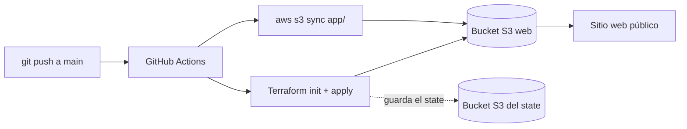

# lab-aws-static-site-cicd

Laboratorio de **BeTek**: despliegue automático de un sitio web estático en **AWS S3** usando **Terraform** como infraestructura como código y **GitHub Actions** como herramienta de CI/CD.

Cada vez que se hace `push` a la rama `main`, el pipeline crea (o actualiza) la infraestructura en AWS y publica el sitio, sin ningún paso manual.

---

## ¿Qué se construye?

Un pipeline que, en una sola ejecución:

1. **Crea la infraestructura** con Terraform: un bucket de S3 configurado como sitio web estático, con su política de lectura pública.
2. **Sincroniza el sitio** (`app/`) con ese bucket usando `aws s3 sync`.
3. **Muestra la URL pública** del sitio en el log de la ejecución.



## Tecnologías

| Herramienta | Uso |
|---|---|
| GitHub Actions | Orquestar el pipeline de CI/CD |
| Terraform | Definir y crear la infraestructura (IaC) |
| AWS S3 | Alojar el sitio estático y guardar el state de Terraform |
| AWS CLI | Subir los archivos del sitio al bucket |
| HTML + CSS | Sitio web de ejemplo |
| Conventional Commits | Convención para los mensajes de commit |

## Estructura del proyecto

```
lab-aws-static-site-cicd/
├── .github/
│   └── workflows/
│       └── deploy.yml     # Pipeline de despliegue continuo
├── app/
│   ├── index.html         # Sitio web estático
│   └── styles.css         # Estilos del sitio
├── infra/
│   └── main.tf            # Infraestructura con Terraform
└── README.md
```

## Cómo funciona

### Infraestructura: `infra/main.tf`

- **Backend remoto:** el *state* de Terraform se guarda en un bucket de S3 (`bucket-luiscarlos-terraform`), porque el runner de GitHub Actions es una máquina temporal y el state no puede perderse entre ejecuciones. Este bucket se crea **manualmente una sola vez**, ya que debe existir antes del `terraform init`.
- **Bucket del sitio web:** `luiscarlos-static-site-lab`, creado por Terraform, con tags `Name` y `Environment`.
- **Configuración de sitio web:** `index.html` como documento principal.
- **Acceso público y política de lectura:** se desactiva el bloqueo de acceso público y se permite `s3:GetObject` para que el contenido se pueda leer desde internet. Un `depends_on` garantiza que la política se aplique **después** del cambio en el bloqueo público.
- **Outputs:** `bucket_name` y `website_url`.

### Pipeline: `.github/workflows/deploy.yml`

Se dispara con cada `push` a `main` y ejecuta estos pasos en `ubuntu-latest`:

| # | Paso | Qué hace |
|---|---|---|
| 1 | Checkout code | Descarga el repositorio |
| 2 | Configure AWS Credentials | Autentica contra AWS con los secretos del repositorio |
| 3 | Setup Terraform | Instala Terraform |
| 4 | Terraform Init | Inicializa y conecta con el state en S3 |
| 5 | Terraform Apply | Crea la infraestructura (`-auto-approve`) |
| 6 | Get bucket name | Lee el output `bucket_name` y lo guarda para el siguiente paso |
| 7 | Deploy to S3 | `aws s3 sync app/` hacia el bucket, con `--delete` |
| 8 | Show Website URL | Imprime la URL pública del sitio |

### Términos clave

- **Workflow:** el archivo `.yml` completo; el proceso automatizado.
- **Event:** el disparador (aquí, `push` a `main`).
- **Job:** conjunto de pasos que corren en una misma máquina.
- **Step:** tarea individual dentro de un job.

## Requisitos previos

- Cuenta de GitHub y Git instalado.
- Cuenta de AWS y un usuario IAM con **Access Key**.
- Un bucket de S3 creado a mano para el state de Terraform, en `us-east-1`, privado y con *versioning* activado.
- Nombres de bucket **únicos a nivel mundial**: hay que adaptarlos en `infra/main.tf` (el `backend`, el recurso `web` y el `Resource` de la política).

### Permisos IAM necesarios

El usuario IAM del pipeline necesita permisos de S3 sobre los dos buckets (state y sitio web), entre ellos `s3:CreateBucket`, `s3:PutBucketWebsite`, `s3:PutBucketPublicAccessBlock`, `s3:PutBucketPolicy`, `s3:GetObject`, `s3:PutObject`, `s3:DeleteObject` y `s3:ListBucket`.

## Configuración de secretos

Las credenciales **nunca** van en el código. Se guardan en GitHub:

`Settings → Secrets and variables → Actions → New repository secret`

| Nombre del secreto | Valor |
|---|---|
| `AWS_ACCESS_KEY_ID` | Access Key ID del usuario IAM |
| `AWS_SECRET_ACCESS_KEY` | Secret access key del usuario IAM |

## Uso

```bash
git add .
git commit -m "feat: actualizar el sitio"
git push
```

El push dispara el pipeline automáticamente. El progreso y los logs se ven en la pestaña **Actions** del repositorio, y en el paso *Show Website URL* aparece la dirección del sitio:

```
http://luiscarlos-static-site-lab.s3-website-us-east-1.amazonaws.com
```

Para comprobar el redespliegue automático, se edita `app/index.html` (por ejemplo, cambiando "Versión 1" por "Versión 2") y se hace un nuevo push.

## Convención de commits

Se usan [Conventional Commits](https://www.conventionalcommits.org/), con el tipo en inglés y la descripción en español:

```
tipo(alcance opcional): descripción
```

Ejemplos usados en este laboratorio:

- `chore: commit inicial con README`
- `feat(init): configurar sitio estático con terraform y github actions`

## Estado actual y aprendizajes

- ✅ Repositorio, estructura y sitio web creados.
- ✅ Bucket del state creado y `terraform init` exitoso.
- ✅ `terraform plan` correcto: 4 recursos por crear.
- ⚠️ El `terraform apply` falló con `AccessDenied` porque el usuario IAM de la cuenta de entrenamiento no tenía los permisos `s3:PutBucketWebsite` ni `s3:PutBucketPublicAccessBlock`. El código es válido; el bloqueo es de **permisos de AWS**, no de Terraform ni de GitHub Actions.
- 🔜 Pendiente: solicitar la ampliación de permisos al administrador de la cuenta y volver a ejecutar el pipeline (*Re-run jobs*).

> Esta sección debe actualizarse cuando el pipeline termine con éxito.

**Lecciones del laboratorio**

- El mensaje genérico `exit code 1` no indica la causa: hay que abrir el paso con la X roja y leer las líneas `Error:`.
- Un error de permisos (IAM) se distingue de un error de código porque el `plan` se genera bien y falla al **aplicar**.
- Terraform guarda en el state lo que sí alcanzó a crear, así que un reintento continúa desde ese punto.

## Seguridad y limpieza

- El bucket del sitio es **público a propósito**, porque sirve contenido web. No debe usarse para datos sensibles.
- El bucket del state es **privado** y no debe borrarse mientras existan recursos gestionados por Terraform.
- Al terminar el laboratorio: vaciar y eliminar los buckets (o ejecutar `terraform destroy` con las credenciales adecuadas) y **desactivar o eliminar la Access Key** en IAM.

## Evidencias

El paso a paso del laboratorio, con capturas, está documentado en [`docs/lab-aws-static-site-cicd.pdf`](docs/lab-aws-static-site-cicd.pdf).

---

*Laboratorio del curso de AWS con [BeTek](https://www.betek.la).*
